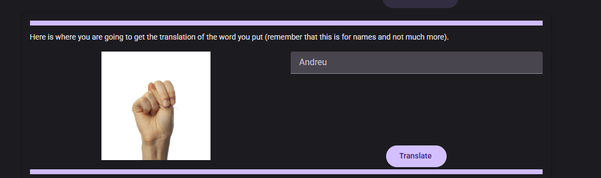
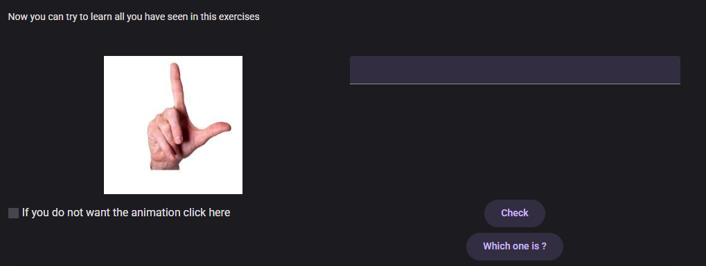
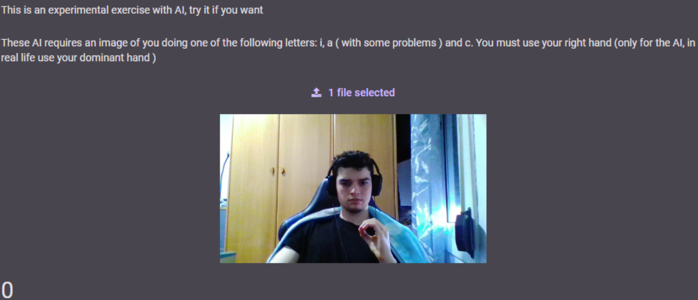

# Sign language translator with AI

A web app to learn fingerspelling (the manual alphabet) and a computer vision model that recognizes signed letters from a webcam photo.

> My high school research project (*Treball de Recerca*, 2022-2023). It was my first big AI project.

**Try it:** the American Sign Language (ASL) version is live at [singsasl.anvil.app](https://singsasl.anvil.app). There is also a [presentation of the project](https://prezi.com/p/6jdzvdahvwat/shorted-i-can/).

## Screenshots

**Name translator**: type a name and the app spells it sign by sign.

**Exercises**: the app shows a sign and you type the letter.

**AI exercise** (experimental): upload a photo of yourself signing a letter and the model tells you which one it is.

## What it does

**Learning web app** (built with [Anvil](https://anvil.works), in Python)
- Intro theory, vowels and consonants of the alphabet, with a picture of each sign.
- **Quiz** with random, non-repeating questions and a final score.
- **Name translator**: spells out in signs whatever name you type.

**Sign recognition with AI**
1. **Dataset capture**: an OpenCV script takes webcam photos for each letter (`0.5_version/training/recordScript`).
2. **Labeling** the images with [labelImg](https://github.com/HumanSignal/labelImg) (bounding boxes in Pascal VOC format).
3. **Training** a [YOLOv5](https://github.com/ultralytics/yolov5) model on Google Colab.
4. **Connecting it to the web app** through Anvil Uplink: the app sends the photo, the model detects the letter and returns the result.

Before YOLOv5 I tried TensorFlow Object Detection (SSD MobileNet), in `PaginaWeb/Codi_IA_experimental`.

## Versions

| Folder | Version |
|---|---|
| `PaginaWeb/` | v0.21: learning web app and first AI experiments |
| `0.5_version/` | v0.5: web app connected to the YOLOv5 model |
| `TR_V.0.5_English_American/` | v0.5 adapted to American Sign Language (ASL) |

## Tech

Python · Anvil · YOLOv5 (PyTorch) · OpenCV · labelImg · Google Colab · Jupyter

## Limitations

- The dataset is very small (a few photos per letter, all taken by me) and only covers some letters (in this repo: I, O and U), so the model does not generalize well to other hands or backgrounds.
- It recognizes static letters in a photo, not signs in motion or real-time video.

## What I would do today

- Use hand keypoints (for example, MediaPipe Hands) instead of object detection, which needs far less data.
- Grow the dataset with more people and backgrounds.
- Real-time recognition on video.
